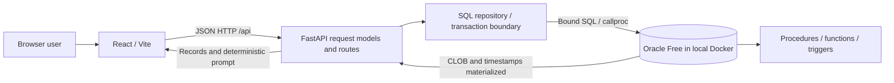

# Architecture

ContextDB persists knowledge about projects. Agents are metadata records. Sessions describe recorded interactions; neither entity is a live worker or a model invocation.

## Responsibilities

- `frontend/src/App.jsx` owns routes. `AppShell.jsx` owns project selection, refresh version and notices. The project is encoded in `?project=ID`; refresh and direct links preserve the chosen project. A project change remounts lists to reset pagination and filters.
- `services/apiClient.js` owns fetch, JSON, URL query construction and error translation. `hooks/useResource.js` loads records and cancels obsolete requests.
- Pages select layouts appropriate to their data: tables for memories/tasks/history, compact agent cards, detail pages for projects/tasks/agents/sessions and Radix dialogs for edits. `components/ui` contains editable shadcn/ui-derived primitives, built with Radix and class-variance-authority. The manual foundation follows the [official Vite setup](https://ui.shadcn.com/docs/installation/vite); no template dashboard is used.
- `backend/main.py` declares HTTP routes. `models.py` defines allowed values and PATCH semantics. `repository.py` contains shared queries, joins, association validation and tag handling.
- `db.py` opens a Thin-mode connection per request, sets UTC, bounds call time, commits only after success, rolls back every failed operation, closes the connection and sanitizes Oracle errors. Cursor contexts close before connections. CLOB handles are read while the connection is alive.
- `04_plsql_programs.sql` owns database business operations; these programs do not commit. The caller owns transaction boundaries. The API uses procedures for assignment/status and functions for scoring/project open-task counts.

## Memory transaction

POST validates the project and optional task/session ownership, inserts the memory with `RETURNING`, then inserts unique tag mappings. A bad tag FK causes a rollback of both memory and mappings. PATCH locks the existing row, checks merged optional associations, replaces tags and updates fields in one transaction. Tag-only changes also update the memory timestamp. API mutations cannot move an existing memory/task into another project, preventing indirect cross-project associations. Direct SQL users must follow the same ownership rule; the existing single-column FKs do not enforce that rule alone.

## Ranking

`fn_memory_relevance(memory_id)` returns `importance * 10 + tag_count * 5`. Filtering happens before ranking. Results sort by score descending, then memory ID ascending for stable ties. Context defaults to five memories and allows 1–20. Project existence is checked separately: a missing project returns 404; an empty selection returns 200 with an empty array and helpful prompt text.

This is a heuristic. It does not compute embeddings, understand semantic similarity, run an LLM, or estimate token budgets. A memory with more tags may outrank an otherwise more important memory. Scores and contributing factors are visible for review. Content remains plain text, including whitespace and code indentation.

## Consistency and scope

Project totals use independent subqueries instead of multiplying two one-to-many joins. `BLOCKED` counts as open work. Agent-related knowledge is joined through task assignments or source sessions; no direct agent ownership is invented. Detail views cap related sections at 200 records, while task/memory/session lists paginate at 25 records in the UI and at most 200 per API request. Associations in editors show up to 200 project tasks/sessions.

The course app is local and trusted; there is no account login, tenant access control, background runtime, or external SaaS. CORS permits explicit local origins without credentialed wildcard access. SQL identifiers come only from code constants; all request values use binds. Database credentials live solely in the backend environment.

## Timestamp convention

The baseline TIMESTAMP columns have no timezone. The inspected database system/session timezone was UTC. API connections explicitly use UTC, and Python attaches UTC when serializing these values. Browser display uses the viewer's local timezone. Adopting a database whose historical timestamps were recorded in another zone requires an explicit migration; blindly relabeling historical local times as UTC is incorrect.
