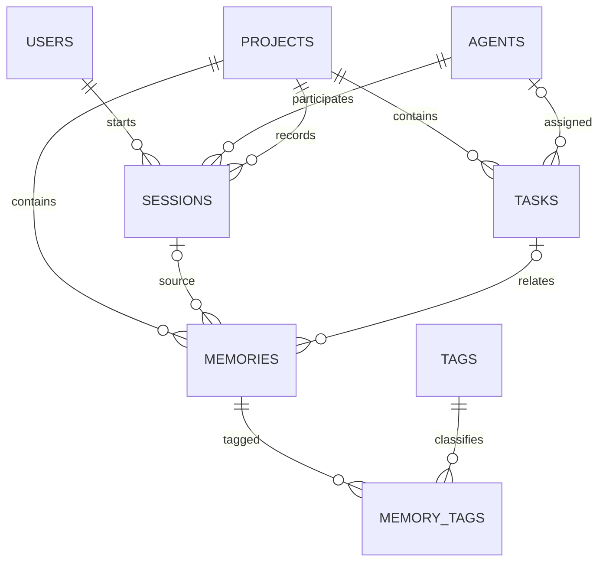

# Oracle database design

Exactly eight **ContextDB application tables** are preserved. The existing shared course schema also contains unrelated tables; application verification explicitly scopes itself to these eight. Clean-install verification uses a dedicated temporary schema with exactly these eight tables.

## Relational schema

- `USERS(user_id PK identity, name, email UNIQUE, role, created_at)`
- `AGENTS(agent_id PK identity, agent_name UNIQUE, model_name, model_version, created_at)`
- `PROJECTS(project_id PK identity, project_name UNIQUE, description, status, created_at)`
- `SESSIONS(session_id PK identity, user_id FK, agent_id FK, project_id FK, start_time, end_time NULL, status)`
- `TASKS(task_id PK identity, project_id FK, agent_id FK NULL, title, description, priority, status, created_at, completed_at NULL)`
- `MEMORIES(memory_id PK identity, project_id FK, session_id FK NULL, task_id FK NULL, title, content CLOB, memory_type, importance, created_at, updated_at)`
- `TAGS(tag_id PK identity, tag_name UNIQUE, created_at)`
- `MEMORY_TAGS(memory_id PK/FK, tag_id PK/FK)` with a composite primary key.

All columns except the explicitly nullable associations/end/completion times are NOT NULL. Numeric identities permit explicit seed IDs. After seeding, `START WITH LIMIT VALUE` moves each identity generator above its table's existing maximum. No ninth table or agent-ownership column was added.

## Domains, defaults and relations

Roles: DEVELOPER, ARCHITECT, QA, ADMIN, TECH_LEAD. Project statuses: ACTIVE, ON_HOLD, COMPLETED, ARCHIVED. Task statuses: OPEN, IN_PROGRESS, COMPLETED, BLOCKED; priorities LOW, MEDIUM, HIGH, CRITICAL. Session statuses: ACTIVE, COMPLETED, ABORTED. Memory types: REQUIREMENT, DECISION, CONSTRAINT, BUG, SOLUTION, FINDING, RULE. Importance is 1–5. Session end time cannot precede start time. DDL defines creation/default timestamps, OPEN tasks, MEDIUM priority, ACTIVE projects/sessions and importance 3.

Project deletion cascades tasks, sessions and memories. User/agent deletion cascades their sessions. Agent deletion unassigns tasks. Task/session deletion clears the corresponding memory association. Memory/tag deletion cascades only mapping rows. UI confirmations describe supported destructive operations. Agent/user deletion is not exposed by the API.

Memories are project knowledge, optionally associated with a task/session. The API rejects associations from another project and makes project IDs immutable after creation. The baseline FKs independently verify existence; direct SQL writes must maintain the same project association rule. Indexes support project/type/importance lookup, project/status task lookup, session users/agents and memory task lookup.

## Script order and safety

1. `01_schema.sql`: DDL for a **new empty schema only**. It now refuses existing tables rather than dropping them. Do not use it for upgrades.
2. `02_seed.sql`: clean-only seed, refusing existing rows. Counts: USERS 10, AGENTS 10, PROJECTS 10, SESSIONS 12, TASKS 13, MEMORIES 15, TAGS 10, MEMORY_TAGS 20.
3. `04_plsql_programs.sql`: non-destructive CREATE OR REPLACE of seven application objects. Re-runnable. Does not rewrite historical rows or completion timestamps. DDL commits automatically in Oracle; run from a separate SQL*Plus session with no pending work.
4. `03_crud_and_queries.sql`: rollback-only INSERT/UPDATE/DELETE demonstration plus original Q1–Q15. Uses generated IDs for temporary rows; demo references baseline project 1/task 12/session 11/tag 8, so run where seed relationships remain intact. Historical fixed-ID demo rows are retained if already present.
5. `05_plsql_demo.sql`: temporary project/tasks/memory, procedures/functions/cursor/triggers, controlled errors, invalid-tag rollback and mapping cascade. Ends with rollback; identity values consumed by tests are not reused.
6. `06_verification.sql`: eight application table counts, all relevant constraints, program status, compilation errors and cross-project association audit. Stops if any required table is missing or has fewer than 10 rows.

Use `python -m scripts.run_sql PATH` after installing backend dependencies. The wrapper reads credentials from backend/.env and sends them through SQL*Plus stdin, not process arguments. Scripts stop on SQL errors. Output evidence contains no passwords. Each script exits SQL*Plus; invoke separately.

## PL/SQL components

- `sp_assign_task(task_id, agent_id)`: locks/checks task, validates optional agent, assigns or clears the FK. Errors -20001 task missing; -20002 agent missing. Called by task creation, PATCH and PUT assignment.
- `sp_update_task_status(task_id, status)`: validates the four statuses, updates the task or reports -20001/-20003. Called by task creation, PATCH and PUT status. No artificial transition restrictions: every status can be reopened.
- `fn_memory_relevance(memory_id)`: importance × 10 + tag mappings × 5; -20004 if missing. Used in memory list/detail and context selection.
- `fn_project_open_task_count(project_id)`: all tasks except COMPLETED, including BLOCKED; -20005 if missing. Used in project summaries.
- `sp_project_task_report(project_id)`: explicitly declares a cursor, loops through all project tasks, prints ID/status/title and aggregate totals using DBMS_OUTPUT. Demo processes two temporary rows.
- `trg_memories_updated_at`: BEFORE UPDATE row trigger stamps current time. API tag-only edits also touch the memory row so the timestamp changes.
- `trg_tasks_completion_stamp`: BEFORE INSERT/UPDATE of status/completed_at. A newly completed task is stamped; repeating COMPLETED preserves its stamp; reopening clears it. Initial COMPLETED inserts preserve an explicitly supplied historical stamp, otherwise set current time. Initial non-completed inserts clear completion time.

No procedure/trigger commits; the API or SQL*Plus demo owns commit/rollback. New timestamps use UTC in the API; see architecture for historical timestamp assumptions.

## Query coverage

Q1 domain/project filters; Q2 task status/priority; Q3 title and CLOB keyword search; Q4 user/session/agent/project join; Q5 memory tags; Q6 task-produced architecture/bugs; Q7 agent left join including unassigned; Q8 memory grouping/average; Q9 completed/total project tasks; Q10 HAVING on popular tags; Q11 model/session/memory aggregates; Q12 correlated above-average subquery; Q13 NOT EXISTS tasks without memory; Q14 nested project membership; Q15 top-ranked project context.

Actual new captures: [SQL queries](evidence/query_outputs.txt), [PL/SQL demo](evidence/plsql_demo.txt), [shared-schema verification](evidence/database_verification.txt), [clean-schema execution](evidence/clean_schema_verification.txt). Existing captures in the parent docs folder are historical, not substituted for new executions.
