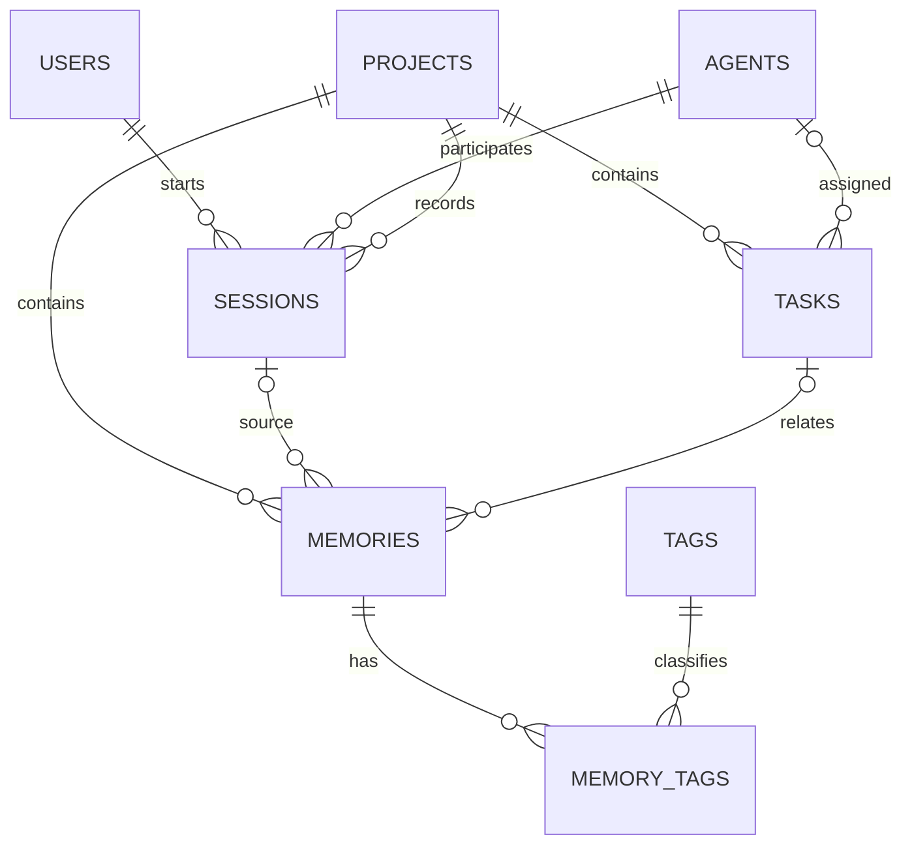

# ContextDB — Final Database Systems Course Report

## 1. Title and problem statement

**Persistent Project Memory & Context Management System**. AI-assisted software projects accumulate requirements, constraints, architecture decisions and debugging findings across conversations. ContextDB persists that information in a relational Oracle database so developers can retrieve consistent project context later. It manages knowledge and work records; it does not claim to run autonomous agents.

## 2. Objectives and requirements

Provide a real React → FastAPI → Oracle application for project overview, memory CRUD/search/tags, task assignment/status, session history, agent contributions and deterministic context assembly. Preserve the eight-table academic design, constraints, meaningful seed rows, 15 SQL queries, transactional CRUD and executable PL/SQL business operations.

The application has no LLM dependency. A rule-based score ranks stored knowledge; the user can review and copy the resulting prompt into another workflow.

## 3. ER model and relational schema

The eight relations are USERS, AGENTS, PROJECTS, SESSIONS, TASKS, MEMORIES, TAGS and MEMORY_TAGS. All entity tables use generated numeric primary keys; MEMORY_TAGS uses `(memory_id, tag_id)` as a composite key. Names/emails with identity semantics have UNIQUE constraints. FK actions cascade dependent project records, set optional associations to null, and remove only tag mappings when appropriate. Domain CHECKs restrict types, statuses, priorities, roles, importance and session chronology.

[DATABASE.md](DATABASE.md) contains the full attribute-level relational schema and relationship semantics. [01_schema.sql](../database/01_schema.sql) is the authoritative executable DDL; it is now guarded against accidental use on a populated schema. The design remains recognizable and no ninth table was added.

## 4. Implementation and connectivity

React/Vite provides the light Editorial Operations Console, with tables, detailed records, accessible Radix edit dialogs, filters, meaningful connection errors and confirmations. FastAPI validates input, binds SQL values, converts CLOBs to text and wraps each request in a transaction. Oracle is locally hosted in Docker with persistent storage and python-oracledb Thin connectivity.

Configuration comes from environment variables; hardcoded fallback credentials were removed. CORS has an explicit local allowlist. The frontend contains no database credentials and does not connect directly to Oracle. The trusted local application does not yet include authentication or multi-user authorization.

[ARCHITECTURE.md](ARCHITECTURE.md) explains the data flow; [API.md](API.md) documents routes and request/response behavior.

## 5. Seed data and constraints

Clean seed verified through SQL*Plus in a temporary schema: USERS 10, AGENTS 10, PROJECTS 10, SESSIONS 12, TASKS 13, MEMORIES 15, TAGS 10, MEMORY_TAGS 20. The isolated schema was asserted to contain exactly eight total tables. All primary/foreign/unique/check/NOT NULL constraints were inspected and enabled.

The existing shared coursework schema contains unrelated tables, which were preserved. Its ContextDB counts remain 10/10/10/12/13/16/10/21 in the order above because it already contained an earlier CRUD demonstration memory and mapping. No reset/reseed was performed. Repeating clean schema/seed initialization was tested and correctly rejected rather than overwriting data.

Evidence: [clean SQL execution](evidence/clean_schema_verification.txt), [constraint/count verification](evidence/database_verification.txt), [initialization guard checks](evidence/initialization_guards.txt).

## 6. SQL queries and CRUD

[03_crud_and_queries.sql](../database/03_crud_and_queries.sql) retains all 15 meaningful queries: filters and CLOB search, multi-table joins, left joins, grouping and averages, HAVING, correlated subqueries, EXISTS/NOT EXISTS, nested project membership and ranked top-N context. The script demonstrates INSERT, UPDATE and DELETE with before/after output and a cascading mapping deletion, then rolls back demonstration changes.

[Actual new query output](evidence/query_outputs.txt) records execution against the existing database. Query results vary with legitimate data changes; no result rows or screenshots were fabricated. Original intermediate output files remain historical evidence and were not replaced.

## 7. PL/SQL programs

[04_plsql_programs.sql](../database/04_plsql_programs.sql) installs:

- **Three procedures:** task assignment with nullable agent validation, task status update, and a project task report.
- **Two functions:** memory relevance score and open-task count including blocked work.
- **One explicit cursor:** the task report loops over project tasks and prints ID/title/status plus totals. The demo processes two rows.
- **Two triggers:** memory update timestamp and task completion timestamp. Completing stamps time, repeating completion preserves it, and reopening clears it.

The business procedures are called from actual API endpoints; functions serve project summaries and context ranking. Procedures/triggers do not commit independently. Application transactions own success/rollback. [Installation evidence](evidence/plsql_install.txt) reports all seven objects VALID.

[05_plsql_demo.sql](../database/05_plsql_demo.sql) calls procedures/functions, displays cursor output and trigger before/after values, handles expected negative cases, demonstrates invalid-tag rollback and cascades, and leaves zero temporary projects after rollback. [Actual output](evidence/plsql_demo.txt) includes a score of 40 and two open tasks for the temporary example, plus a mapping count transition of 1 to 0.

## 8. Interactive transactions and context ranking

Memory creation writes MEMORIES and MEMORY_TAGS atomically. An invalid tag fails the entire write; editing to an invalid tag restores the previous memory and mappings. The server rejects task/session associations from another project. Task assignment calls `sp_assign_task`; status changes call `sp_update_task_status` and invoke the completion trigger. Deleting a task preserves its knowledge with a null association. Project summaries avoid inflated join counts.

Context scores equal `importance * 10 + tag_count * 5`, ordered descending then by memory ID. The UI displays factors and the score, retrieves selected CLOB text, assembles a plain-text prompt and provides copying feedback. This is deterministic retrieval, not semantic/vector search or an AI response.

Use [DEMO_WALKTHROUGH.md](DEMO_WALKTHROUGH.md) for a precise operation → endpoint → SQL/PLSQL → tables → result narrative.

## 9. Verification results and limits

- **29 backend tests passed**, including real Oracle success and failure paths.
- **10 frontend tests passed**, including two React/jsdom → live HTTP → Oracle flows.
- Vite production build passed; npm audit reported **zero vulnerabilities**.
- Real network HTTP smoke test passed and restored all eight table counts.
- All six SQL scripts passed in an isolated schema, then that temporary schema was removed.
- SQL*Plus demos proved procedures/functions, multi-row cursor processing, triggers, CRUD, cascade and rollback.
- Python import/compile checks, static undefined/unused checks, diff whitespace checks and Compose configuration validation passed.

Full commands and outputs are in [VERIFICATION.md](VERIFICATION.md). Starlette emitted one TestClient deprecation warning. A real browser was unavailable, so desktop/mobile visual review, screenshots, browser-rendered contrast and system clipboard behavior remain manual checks. No visual testing success is claimed. The optional pinned new Compose image was not booted; existing Oracle 23.26.2 was used.

## 10. Course compliance

- [x] Eight related application tables, preserved and documented.
- [x] PK, FK, UNIQUE, NOT NULL, CHECK and default constraints.
- [x] At least ten meaningful seed records per table, verified in a clean instance.
- [x] ER diagram, relational schema and executable DDL.
- [x] Fifteen meaningful SQL queries with new execution output.
- [x] At least two procedures (implemented three), two functions, one explicit cursor and two triggers.
- [x] INSERT, UPDATE, DELETE, rollback and cascading behavior demonstrated.
- [x] React → FastAPI → Oracle connectivity and real user operations.
- [x] Interactive transaction walkthrough and reproducible tests.
- [x] Final report, architecture, API, setup, demo, evidence and maintenance documentation.
- [ ] Real browser visual review at 1440/768/390px; browser runtime unavailable.

## 11. Conclusion and future work

The completed core application keeps Oracle central to persistent project memory and connects the academic database work to meaningful interactive operations. It preserves existing coursework data and supplies reproducible, rollback-safe demonstrations. Future work may add authentication, concurrent edit conflict detection, server-side search for larger association pickers, token-budgeted prompt assembly, and optional real LLM integration. These are explicitly outside the current core assignment implementation.
