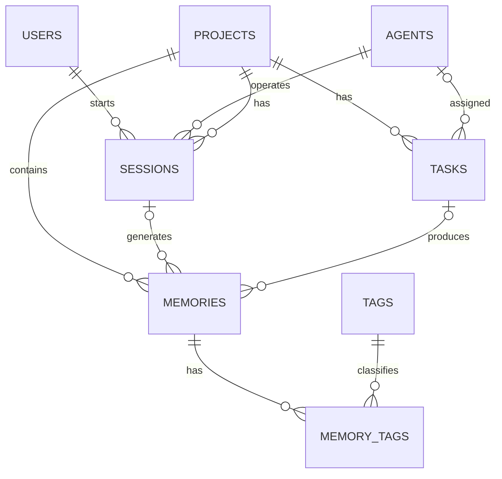

# 1. Project Title

**Persistent Project Memory & Context Management System** — an Oracle-backed memory layer for AI-assisted software engineering.

# 2. Introduction and Problem Statement

AI-assisted projects lose architectural decisions, constraints, and debugging knowledge as conversations end. ContextDB persists that knowledge as structured, searchable records. It links people, AI agents, projects, sessions, tasks, memories, and tags so a later assistant can retrieve the facts that matter instead of relying on a transient chat history.

# 3. Functional Requirements

- Track users, AI agents, projects, work sessions, and tasks.
- Store typed memories: requirements, decisions, constraints, bugs, solutions, findings, and rules.
- Enforce referential integrity, domain validation, and lifecycle deletion rules in Oracle.
- Support memory CRUD, keyword search, tag associations, reporting joins, and ranked context retrieval.
- Expose the database through a Python FastAPI service using `python-oracledb` Thin mode.

# 4. ER Diagram (Mermaid)



# 5. Relational Schema

`USERS(user_id PK, name, email UQ, role, created_at)`  
`AGENTS(agent_id PK, agent_name UQ, model_name, model_version, created_at)`  
`PROJECTS(project_id PK, project_name UQ, description, status, created_at)`  
`SESSIONS(session_id PK, user_id FK, agent_id FK, project_id FK, start_time, end_time, status)`  
`TASKS(task_id PK, project_id FK, agent_id FK NULL, title, description, priority, status, created_at, completed_at)`  
`MEMORIES(memory_id PK, project_id FK, session_id FK NULL, task_id FK NULL, title, content CLOB, memory_type, importance, created_at, updated_at)`  
`TAGS(tag_id PK, tag_name UQ, created_at)`  
`MEMORY_TAGS(memory_id PK/FK, tag_id PK/FK)`

# 6. Table Creation and Constraints

The executable schema is [`database/01_schema.sql`](../database/01_schema.sql). It creates exactly eight tables with named primary keys, foreign keys, unique constraints, `NOT NULL`, defaults, and domain checks. Referential actions preserve integrity: project-dependent data cascades; deleting an agent sets a task assignment to null; deleting a memory cascades its tag mappings. B-tree indexes support memory lookup by project/type/importance and task lookup by project/status.

The deterministic seed script inserts 10 users, 10 agents, 10 projects, 12 sessions, 13 tasks, 15 memories, 10 tags, and 20 mappings. Its SQL*Plus verification output was:

```text
USERS 10 | AGENTS 10 | PROJECTS 10 | SESSIONS 12
TASKS 13 | MEMORIES 15 | TAGS 10 | MEMORY_TAGS 20
```

# 7. SQL Queries and Actual Outputs

[`query_outputs.txt`](query_outputs.txt) is the complete SQL*Plus capture from [`database/03_crud_and_queries.sql`](../database/03_crud_and_queries.sql), including CRUD before/after checks and Q1–Q15. The run completed with zero `ORA-` or `SP2-` errors.

- Q1 returned ContextDB high-importance decision records; Q2 returned high/critical open and in-progress work; and Q3 executed the title/CLOB keyword search.
- Q4–Q7 returned the required joins: user/session/agent/project, memory tags, task-produced memories, and the unassigned-agent left join.
- Q8–Q11 returned grouped memory, task, tag, and model reports.
- Q12 returned four above-project-average memories; Q13 evaluated tasks with no memories through `NOT EXISTS`; and Q14 returned four developers associated with critical-task projects.
- Q15 ranked ContextDB memories by `importance * 10 + tag_count * 5`; the leading scores were 60.

CRUD evidence shows an inserted memory and tag mapping, completion of task 12 and elevation of the memory importance to 5, and a temporary memory deletion that reduced its mapping count from 1 to 0 through `ON DELETE CASCADE`.
